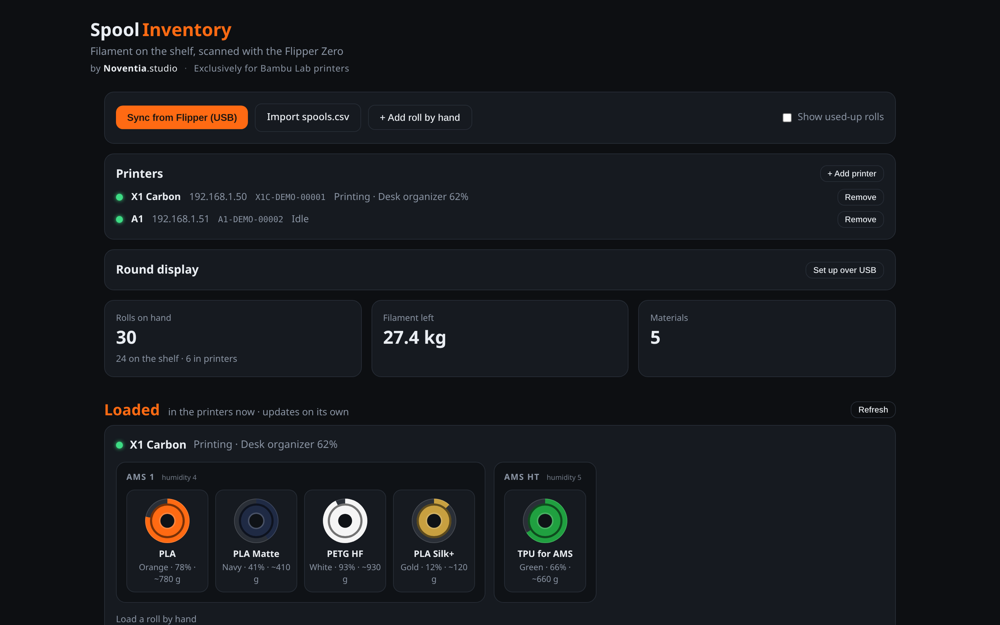
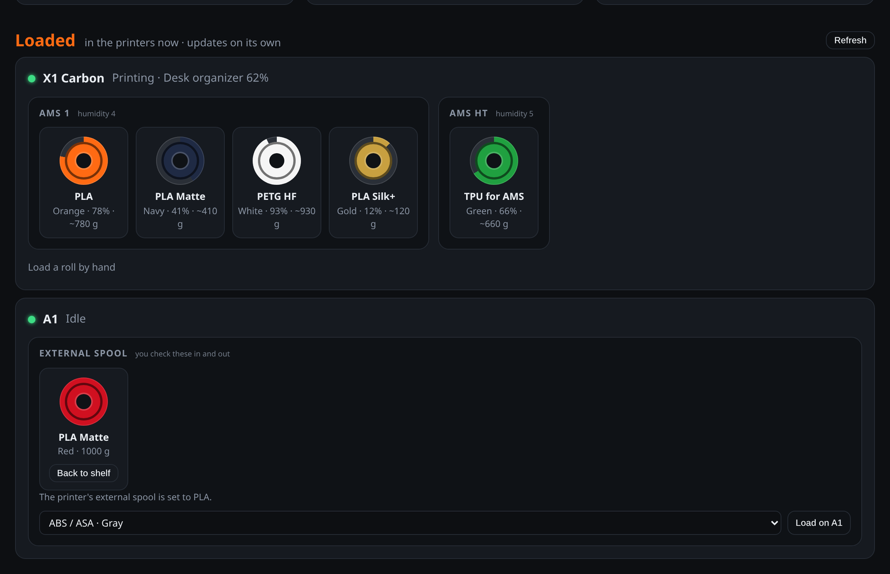
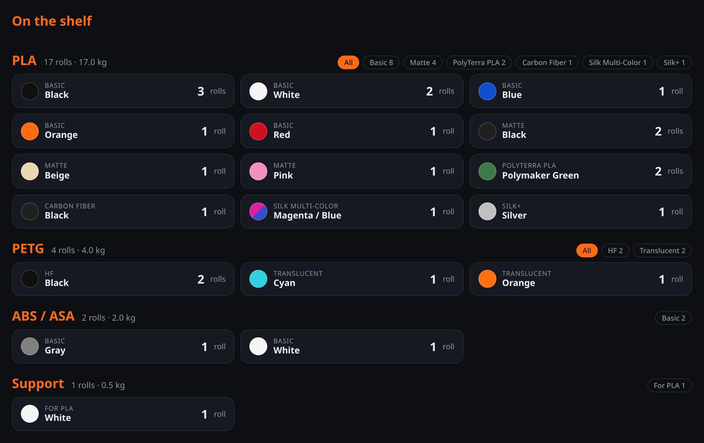
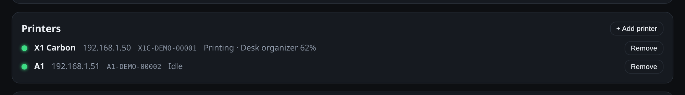
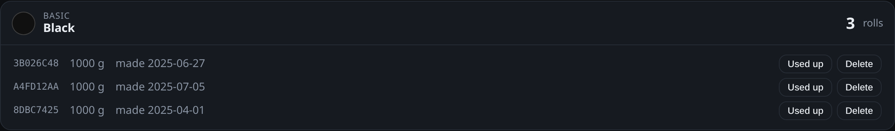
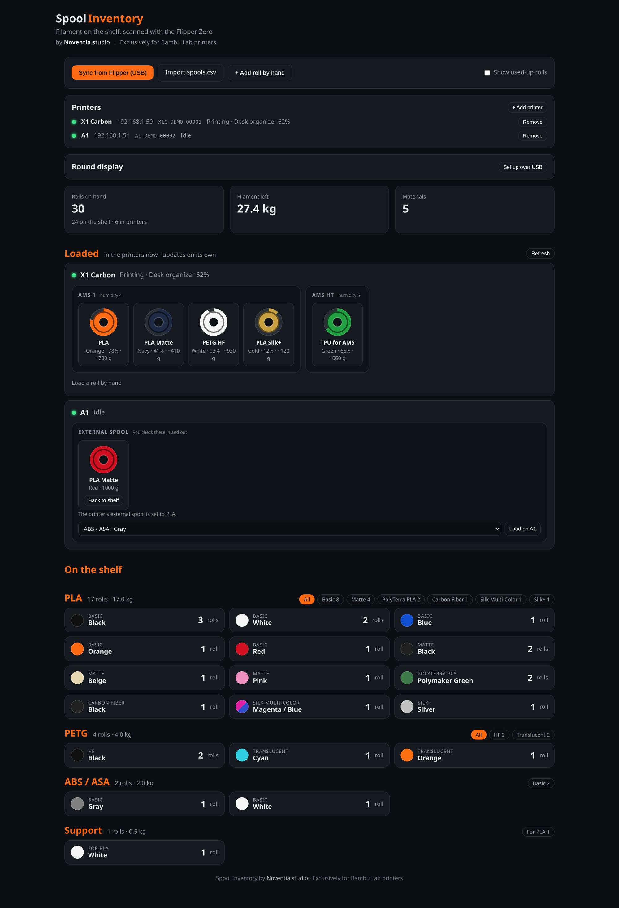
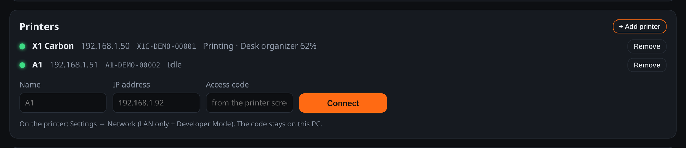
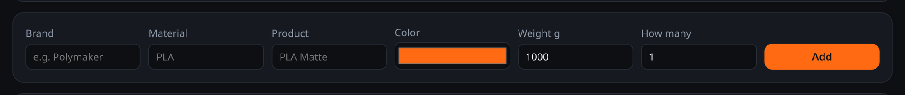

<h1 align="center">Spool Inventory</h1>

<p align="center">
  <b>Know exactly what filament you have, what's loaded, and how much is left.</b><br>
  Spool Inventory by <a href="https://noventia.studio">Noventia.studio</a> · Exclusively for Bambu Lab printers
</p>

<p align="center">
  
</p>

Spool Inventory is a small app you run on your own computer. It connects to your Bambu Lab printers over
your home network, shows what is loaded in every AMS slot and how much is left on each roll, and keeps
count of everything on your shelf. Scan your Bambu rolls with a **Flipper Zero** and sync them over USB, let
the printers add rolls on their own as they pass through the AMS, or add any other brand by hand.

It runs entirely on your network. No account, no cloud, no subscription.

---

## Contents

- [Features](#features)
- [Screenshots](#screenshots)
- [How it works](#how-it-works)
- [What you need](#what-you-need)
- [1. Download](#1-download)
- [2. Install](#2-install)
- [3. Run it](#3-run-it)
- [4. Connect your printers](#4-connect-your-printers)
- [5. Add your rolls](#5-add-your-rolls)
- [Flipper Zero: the Spool Scanner app](#flipper-zero-the-spool-scanner-app)
- [No Flipper Zero?](#no-flipper-zero)
- [Build your own scanner](#build-your-own-scanner)
- [Optional: the round desk display](#optional-the-round-desk-display)
- [Troubleshooting](#troubleshooting)
- [Security](#security)
- [Project layout](#project-layout)
- [Contributing](#contributing)
- [License and credits](#license-and-credits)

---

## Features

- **Track multiple printers at once.** Add every Bambu Lab printer on your network. Each one shows if it's
  online, what it's doing, and the job progress.
- **See what's loaded in every AMS.** A live "Loaded" view shows each AMS (and AMS HT) slot with the roll's
  name, color and humidity, updated on its own as you swap rolls.
- **Know how much is left.** For rolls in an AMS, the printer reports its remaining-filament estimate. Spool
  Inventory shows it as a percentage and in grams.
- **Every spool by name.** Rolls are listed by material, finish and color (PLA Matte · Navy, PETG HF · Black,
  Silk Multi-Color · Magenta / Blue), grouped and counted for you.
- **Shelf inventory.** Everything that isn't in a printer is "on the shelf", sorted by material, then finish,
  then color, with roll counts and kilograms on hand. Tap a finish chip to filter.
- **No double counting.** Each Bambu roll has a unique ID on its RFID tag. Scan it twice, sync twice, load it in
  the AMS: it's still one roll.
- **Rolls check themselves in and out.** Put a roll in the AMS and it moves from the shelf to the printer. Take
  it out and it's back on the shelf.
- **A1 / external spool support.** For printers without an AMS, pick the roll you put on and press **Load**.
  Press **Back to shelf** when you take it off.
- **Flipper Zero scanning.** The included Spool Scanner app reads Bambu Lab spool tags (material, color,
  weight, diameter, production date) and the web page syncs them straight off the Flipper over USB.
- **Any brand, by hand.** Polymaker, eSun, Elegoo, whatever: add rolls with brand, material, color and weight.
- **CSV import.** Import a `spools.csv` file from the Flipper's SD card (or from your own tool, see
  [Build your own scanner](#build-your-own-scanner)).
- **Used-up tracking.** Mark a roll used up; it drops out of your totals but stays in the history.
- **Optional round desk display.** A 1.75" round touch AMOLED that shows your stock and printers at a glance.

## Screenshots

> All screenshots use sample data and demo printers.

| Loaded: every AMS slot, live | On the shelf: by material, finish and color |
|---|---|
|  |  |

| Printers | Each roll, individually |
|---|---|
|  |  |

<details>
<summary>Full page</summary>


</details>

## How it works

```
 Flipper Zero ──USB──┐
 (Spool Scanner app) │
                     ▼
              ┌──────────────┐   MQTT over TLS (LAN)   ┌───────────────────────┐
  Browser ◄──►│ Spool        │◄───────────────────────►│ Bambu Lab printers    │
 (localhost)  │ Inventory    │   AMS slots, remaining  │ (LAN Only + Dev Mode) │
              │ (Node.js)    │   %, job status         └───────────────────────┘
              └──────┬───────┘
                     │ read-only feed (optional)
                     ▼
              Round desk display (ESP32-S3)
```

- The app is a small Node.js server with a built-in SQLite database (`data/inventory.db`).
- Each printer is reached directly on your network, the same way Bambu Studio talks to it in LAN mode.
  The printer reports every AMS slot, the roll's unique tag ID and its remaining-filament estimate.
- The Flipper Zero reads the RFID tag on each Bambu spool and saves it to its SD card. The web page reads that
  file off the Flipper over USB (Web Serial) and adds any rolls it hasn't seen.
- Rolls are matched by the tag's unique tray ID, so the Flipper and the printers always agree on which roll is which.

## What you need

| | |
|---|---|
| **Computer** | Windows, macOS or Linux. It needs to be on the same network as your printers and on while you want live status. |
| **Node.js** | Version **22.13 or newer** (22 LTS or 24 LTS recommended). The app uses Node's built-in SQLite. |
| **Browser** | Any modern browser to view it. **Chrome or Edge** for USB sync from the Flipper and display setup (they support Web Serial; Firefox and Safari don't). |
| **Printer** | One or more Bambu Lab printers (X1 / P1 / A1 series and newer) with **LAN Only mode and Developer Mode** turned on, so third-party apps can read their status. |
| **Optional add-ons** | Spool Inventory is programmed for two add-ons: a small round desk display, the [Waveshare ESP32-S3-Touch-AMOLED-1.75](https://www.waveshare.com/esp32-s3-touch-amoled-1.75.htm) (a case for it is planned but not available yet), and a [Flipper Zero](https://flipperzero.one) to scan spool tags. You don't have to use either one, but they make life a lot easier. |

## 1. Download

**With git:**

```bash
git clone https://github.com/sfandetti/spool-inventory.git
cd spool-inventory
```

**Without git:** on the GitHub page click **Code → Download ZIP**, unzip it, and open a terminal
(PowerShell on Windows, Terminal on macOS) in the unzipped `spool-inventory` folder.

## 2. Install

1. Install Node.js 22.13 or newer from [nodejs.org](https://nodejs.org) (the LTS download is fine).
   Check it in a terminal:
   ```bash
   node -v
   ```
2. Install the app's one dependency (the MQTT client used to talk to the printers):
   ```bash
   npm install
   ```

## 3. Run it

```bash
npm start
```

You should see:

```
Spool Inventory by Noventia.studio: http://localhost:3100 (display feed open on the LAN, read-only)
```

Open **http://localhost:3100** in your browser **on the same computer**. The page and its controls only answer
on that computer (see [Security](#security)).

- Use a different port: `PORT=8080 npm start` (macOS/Linux) or `$env:PORT=8080; npm start` (PowerShell).
- Stop it with `Ctrl+C`. Your data stays in `data/inventory.db`.
- Want to try it with no printer and no Flipper? Click **Import spools.csv** and pick
  [`docs/sample-spools.csv`](docs/sample-spools.csv). Delete `data/inventory.db` afterwards to start fresh.

> **Keep it running:** the printers only report while the app is running. To start it automatically, use
> Task Scheduler (Windows), a LaunchAgent (macOS), a systemd service (Linux), or a process manager like `pm2`.

## 4. Connect your printers

You need two things from each printer: its **IP address** and its **access code**. You do *not* need the
serial number; Spool Inventory reads it from the printer for you.

### Turn on LAN Only mode and Developer Mode

Spool Inventory talks to the printer over your local network, the same way Bambu Studio does in LAN mode.
Recent Bambu firmware only lets third-party apps connect when **LAN Only mode** and **Developer Mode** are
both on. On the printer's screen:

1. Open **Settings** and go to the **Network / WLAN** page (on the A1 and A1 mini it's under **Settings → WLAN**).
2. Turn on **LAN Only** mode.
3. Turn on **Developer Mode** (it appears once LAN Only is on).
4. Note the **IP address** and the 8-character **Access Code** shown on the same page.

> **Heads-up:** in LAN Only mode the printer is disconnected from Bambu's cloud, so remote printing and
> monitoring from Bambu Handy stop working. Bambu Studio and OrcaSlicer can still send jobs over the LAN.
> Menu names vary a little between models and firmware versions.

**Tip:** give each printer a fixed IP address (a "DHCP reservation" in your router settings) so it doesn't
change and drop off.

### Add the printer

1. In Spool Inventory, under **Printers**, click **+ Add printer**.
2. Enter a name (e.g. `X1 Carbon`), the IP address and the access code.
3. Click **Connect**. Within a few seconds the printer shows a green dot, its status, and a **Loaded** card
   with every AMS slot.



Repeat for each printer. The access code is stored only in `data/inventory.db` on your computer and is never
sent to the browser.

## 5. Add your rolls

There are four ways, and you can mix them:

| Way | Best for |
|---|---|
| **Load it in the AMS** | Any Bambu roll you put in an AMS is added automatically, with its remaining %. No scanner needed. |
| **Scan with a Flipper Zero** | Logging your whole shelf of Bambu rolls quickly, without loading each one. |
| **+ Add roll by hand** | Other brands (no Bambu tag), or rolls you don't want to scan. |
| **Import spools.csv** | A file from the Flipper's SD card, or from your own scanner script. |



**How "how much is left" works:** the RFID tag stores the roll's *starting* weight, not what's left. Once a roll
has been in an AMS, the printer's remaining estimate is used (shown as `~410 g left` and a bar). A roll that
has never been in an AMS counts as full until it is.

**For printers without an AMS (like the A1 with an external spool):** the printer can't tell which roll is on
it. In the printer's card pick the roll from the list and press **Load on A1**. Press **Back to shelf** when
you take it off.

---

## Flipper Zero: the Spool Scanner app

The `flipper-app/` folder is a Flipper Zero app that reads the RFID tag inside Bambu Lab spools.

- Bambu tags are MIFARE Classic 1K. Their keys are derived from the tag's UID using the method published by the
  [Bambu Research Group](https://github.com/Bambu-Research-Group/RFID-Tag-Guide), so no key dictionary or
  sniffing is needed.
- For each roll it saves material, product name, color(s), weight, diameter, length and production date to
  `/ext/apps_data/spool_scanner/spools.csv` on the Flipper's SD card.
- Scanning the same roll twice doesn't add it twice.
- The NFC reader is only on while you're scanning (press OK, it stops after one roll, 15 seconds, or Back).

### Install it

**Option A: prebuilt app.** Download `spool_scanner.fap` from the
[latest release](https://github.com/sfandetti/spool-inventory/releases/latest). It is built for the **official
Flipper firmware 1.5.1**. Copy it to your Flipper's SD card at `apps/NFC/` with
[qFlipper](https://flipperzero.one/update) (File manager → SD Card → apps → NFC) or the Flipper mobile app.

> Flipper apps are tied to a firmware API version. If the app says **"API mismatch"** or won't open, build it
> yourself for your firmware (Option B). This always works.

**Option B: build it yourself with ufbt** (the official Flipper app build tool; needs Python 3.8+):

```bash
pip install --upgrade ufbt
cd flipper-app
ufbt update          # downloads the SDK for the official release firmware
ufbt                 # builds dist/spool_scanner.fap
ufbt launch          # (Flipper plugged in by USB, qFlipper closed) installs to apps/NFC and opens it
```

Running a custom firmware? Point ufbt at that firmware's SDK first. For example, for Unleashed:
`ufbt update --index-url=https://up.unleashedflip.com/directory.json`. Use the same release channel as the
firmware on your Flipper. See [`flipper-app/README.md`](flipper-app/README.md) for details.

> **Tested on:** a Flipper Zero running Unleashed firmware (API 88.9). The app also builds cleanly against the
> official 1.5.1 SDK (API 88.2). If you run it on another firmware, let us know how it goes.

### Scan your rolls

1. On the Flipper: **Apps → NFC → Spool Scanner**.
2. Press **OK**. The screen says *"Hold the spool tag to the back of the Flipper."*
3. Hold the back of the Flipper flat against the tag. On Bambu spools it's on the side of the spool, near the hub.
4. Hold still for a second. You'll see the material, color and weight, plus **"Saved - new roll"** or
   **"Already saved"**.
5. Press **OK** to scan the next roll. The top-right corner shows how many rolls are saved; **Back** exits.

### Sync to Spool Inventory

1. Plug the Flipper into the computer running Spool Inventory with a USB cable. Unlock it.
2. **Close qFlipper** (only one program can use the Flipper's USB port at a time).
3. In Chrome or Edge, open http://localhost:3100 and click **Sync from Flipper (USB)**.
4. Pick the Flipper in the pop-up. You'll see e.g. *"Synced: 12 new rolls, 30 already here."*

No Chrome or Edge? Copy `apps_data/spool_scanner/spools.csv` off the SD card with qFlipper and use
**Import spools.csv** instead.

You can keep scanning and syncing as often as you like; the list on the Flipper keeps growing, and only new
rolls are added.

---

## No Flipper Zero?

You can use Spool Inventory fully without one:

- **Got an AMS?** Every Bambu roll you load is added on its own with its remaining amount. Loading each roll
  once is enough to get it on the books.
- **Other brands or no AMS?** Use **+ Add roll by hand**.

### What about a ~$30 USB NFC reader?

Inexpensive USB NFC readers such as the **ACR122U** or a **PN532** USB board (roughly $15–45) can read Bambu
Lab spool tags. Other open-source projects already do it, using the same public key derivation this app uses.

**Spool Inventory doesn't support them out of the box yet.** There's no reader driver in this repo today. The
easy way to add one is to write a small script that reads the tag and writes a `spools.csv` in the format
below, then click **Import spools.csv**. No changes to the app are needed. If you build one, please open a pull
request. See [Build your own scanner](#build-your-own-scanner).

---

## Build your own scanner

Anything that can read a Bambu tag can feed Spool Inventory. You don't need to touch the server: produce a CSV
file with the columns below and import it, or send it to the import endpoint.

### Reading a Bambu Lab tag

1. Read the tag UID (4 bytes) of the MIFARE Classic 1K tag.
2. Derive the 16 sector keys (key A): `HKDF-SHA256(ikm = UID, salt = 9A759CF2C4F7CAFF222CB9769B41BC96,
   info = "RFID-A\0", length = 96)`, split into sixteen 6-byte keys (sector 0 = bytes 0–5, and so on).
   Reference: [`deriveKeys.py`](https://github.com/Bambu-Research-Group/RFID-Tag-Guide/blob/main/deriveKeys.py)
   and [`flipper-app/bambu.c`](flipper-app/bambu.c).
3. Authenticate each sector with its key A and read blocks 1, 2, 4, 5, 9, 12, 14 and 16.
4. Decode them like [`bambu_parse()` in `flipper-app/bambu.c`](flipper-app/bambu.c):

| Block | Bytes | Field |
|---|---|---|
| 1 | 0–7 / 8–15 | `variant_id` / `material_id` (ASCII) |
| 2 | 0–15 | `type`, e.g. `PLA` (ASCII) |
| 4 | 0–15 | `detail`, e.g. `PLA Matte` (ASCII) |
| 5 | 0–3 | color RGBA; 4–5 weight in g (uint16 LE); 8–11 diameter in mm (float32 LE) |
| 9 | 0–15 | **tray UID**: the roll's unique ID, written as 32 hex characters |
| 12 | 0–15 | production date, e.g. `2025_05_17_09_31` (ASCII) |
| 14 | 4–5 | length in m (uint16 LE) |
| 16 | 0–1 = `2` | multi-color info: 2–3 color count (uint16 LE), 4–7 second color stored as ABGR |

### The CSV format

First line is the header, then one line per roll, comma-separated, no quoting:

```
tray_uid,tag_uid,material_id,variant_id,type,detail,color_rgba,color2_rgba,color_count,weight_g,diameter_mm,length_m,produced,scanned_unix
C3D4E5F60718293A4B5C6D7E8F90A1B2,A4C123B1,GFG02,A00-K0,PETG,PETG HF,F5F5F5FF,00000000,1,1000,1.75,330,2025_06_02_07_27,1794431587
```

| Column | Required | Notes |
|---|---|---|
| `tray_uid` | **yes** | 32 hex characters (block 9). This is what prevents double counting. |
| `color_rgba` | **yes** | 8 hex characters, e.g. `FF6A13FF`. |
| `type` | **yes** | Material, e.g. `PLA`, `PETG`, `PLA-CF`, `PLA-S`. |
| `detail` | no | Product name, e.g. `PLA Silk+`. Used for the finish ("Silk+"). |
| `color2_rgba`, `color_count` | no | Second color is used when `color_count` > 1. |
| `weight_g`, `diameter_mm`, `length_m` | no | Numbers. |
| `tag_uid`, `material_id`, `variant_id`, `produced` | no | Stored as-is. |
| `scanned_unix` | no | Unix seconds. If it's missing or looks unset (the Flipper's clock was never set), the import time is used. |

Rows with a bad `tray_uid`, color or missing type are skipped and counted. A full example:
[`docs/sample-spools.csv`](docs/sample-spools.csv).

### Sending it from a script

The import endpoint takes the file contents as JSON. It only answers on the computer running Spool Inventory:

```bash
curl -X POST http://localhost:3100/api/spools/import \
  -H "Content-Type: application/json" \
  --data "$(python3 -c 'import json;print(json.dumps({"csv":open("spools.csv").read()}))')"
# → {"added":12,"known":30,"skipped":0,"spools":[...]}
```

---

## Optional: the round desk display

`display/SpoolDisplay/` is firmware for a **Waveshare ESP32-S3-Touch-AMOLED-1.75** (466×466 round AMOLED with
touch). It shows rolls on hand, kilograms left, your printers and what's loaded, with one swipeable screen per
material.

**Build and flash** with the Arduino IDE 2 or `arduino-cli`:

- Board package: **esp32 by Espressif** 3.3.x, board **ESP32S3 Dev Module**, with
  *USB CDC On Boot: Enabled*, *PSRAM: OPI PSRAM*, *Flash Size: 16MB*,
  *Partition Scheme: 16M Flash (3MB APP/9.9MB FATFS)*.
- Libraries (Library Manager): **GFX Library for Arduino** (moononournation), **U8g2**, **ArduinoJson** (v7),
  **SensorLib** (lewisxhe, for the CST9217 touch controller).
- Optional, for faster drawing: add `-DESP32QSPI_MAX_PIXELS_AT_ONCE=8192` to the C/C++ compiler flags.

```bash
arduino-cli compile --fqbn "esp32:esp32:esp32s3:CDCOnBoot=cdc,PSRAM=opi,FlashSize=16M,PartitionScheme=app3M_fat9M_16MB" display/SpoolDisplay
arduino-cli upload  --fqbn "esp32:esp32:esp32s3:CDCOnBoot=cdc,PSRAM=opi,FlashSize=16M,PartitionScheme=app3M_fat9M_16MB" -p <PORT> display/SpoolDisplay
```

**Set it up:**

1. Plug the display into the computer running Spool Inventory. In Chrome or Edge, the page shows a
   **Round display** card. Click **Set up over USB** and pick the display.
2. Choose your Wi-Fi network, type its password, and pick this computer's address. Click **Send to display**.
3. The display restarts, joins your Wi-Fi, and fetches the feed every 15 seconds. The Wi-Fi password goes over
   the USB cable straight to the display and is stored only on it.

The display reads `http://<this computer>:3100/api/device` over your network. Allow Node.js through your
computer's firewall on private networks if it can't connect.

---

## Troubleshooting

| Problem | Fix |
|---|---|
| `npm start` fails with `No such built-in module: node:sqlite` | Your Node.js is too old. Install 22.13 or newer. |
| Page shows **Forbidden** | You opened it from another device. Open http://localhost:3100 on the computer running the app. |
| *"No printer answering at …"* | Wrong IP, printer off, or LAN Only mode off. Check the IP on the printer's network page and that both devices are on the same network. |
| *"Access code was rejected"* | Remove the printer and add it again with the access code currently shown on the printer (it changes if it's refreshed on the printer). |
| Printer connects but **Loaded** stays empty | Turn on **Developer Mode** on the printer and click **Refresh**. |
| A slot says **not scanned yet** | That roll has no Bambu tag ID the app knows (e.g. a non-Bambu roll set by hand on the printer). Add it by hand if you want it counted. |
| **Sync from Flipper** says it couldn't open the Flipper | Close qFlipper, unplug and replug the Flipper, unlock it, try again. Use Chrome or Edge. |
| *"No spools on the Flipper yet"* | Open Spool Scanner and scan at least one roll first. |
| Flipper app: **API mismatch** | Build it for your firmware with ufbt (see above). |
| Flipper: *not a Bambu spool* / read fails | Hold the tag flat and still against the back of the Flipper. Only Bambu Lab tags are supported. |
| Display stuck on "Joining Wi-Fi" / no data | Check the Wi-Fi password (redo setup), use 2.4 GHz Wi-Fi, and allow port 3100 through the computer's firewall. |
| Printer IPs keep changing | Set a DHCP reservation for each printer in your router. |

## Security

- **Run it on your home network only.** The web page and everything that changes data (adding printers,
  syncing, deleting) answer **only on the computer running the app** (localhost). Requests from other devices
  get `403 Forbidden`.
- **One endpoint is readable on your network:** `/api/device`, the round display's read-only feed (roll counts,
  colors, printer names and job names). It contains no access codes. If you don't use the display and want
  nothing visible on the network, block port 3100 in your firewall.
- **Do not expose it to the internet** (port forwarding, tunnels, reverse proxies) without adding your own
  authentication in front of it.
- Printer access codes are stored in plain text in `data/inventory.db` on your computer and are never sent to
  the browser. Don't share that file or commit it. The `.gitignore` already excludes `data/`.

## Project layout

```
server.mjs            Web server, SQLite database, API
printers.mjs          Printer link (MQTT over TLS, AMS parsing, auto check-in/out)
device-feed.mjs       Material grouping + the round display's feed
public/               The web page (HTML, CSS, JS; Web Serial for Flipper/display)
flipper-app/          Flipper Zero "Spool Scanner" app (C, ufbt)
display/SpoolDisplay/ Round display firmware (Arduino, ESP32-S3)
docs/                 Screenshots and sample data
data/                 Created at runtime: inventory.db (git-ignored)
```

## Contributing

Issues and pull requests are welcome. Especially wanted:

- **A USB NFC reader script** (ACR122U, PN532) that writes the CSV format above.
- Testing the Flipper app on more firmware versions, and the app with more printer models.
- Bug reports with your printer model, firmware version and what you saw.

Please keep changes small and focused, and never include printer serials, IPs, access codes or your
`data/inventory.db` in an issue or pull request.

## License and credits

[MIT](LICENSE) © Noventia.studio

- Bambu tag key derivation and data layout: [Bambu Research Group, RFID-Tag-Guide](https://github.com/Bambu-Research-Group/RFID-Tag-Guide).
- Printer link: [MQTT.js](https://github.com/mqttjs/MQTT.js) (MIT).
- Display: [GFX Library for Arduino](https://github.com/moononournation/Arduino_GFX),
  [U8g2](https://github.com/olikraus/u8g2), [ArduinoJson](https://arduinojson.org),
  [SensorLib](https://github.com/lewisxhe/SensorLib).

*Spool Inventory is an independent project. It is not affiliated with, endorsed by, or sponsored by Bambu Lab
or Flipper Devices Inc. "Bambu Lab", "AMS" and "Flipper Zero" are trademarks of their respective owners.
Reading your own spool tags is for personal inventory use; this project does not write, clone or modify tags.*
